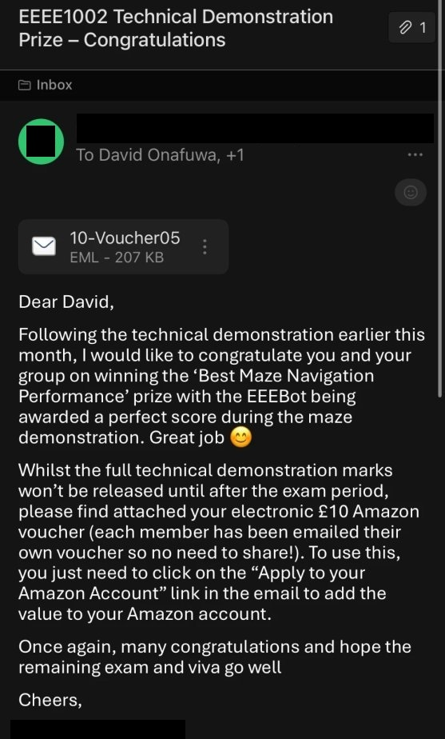
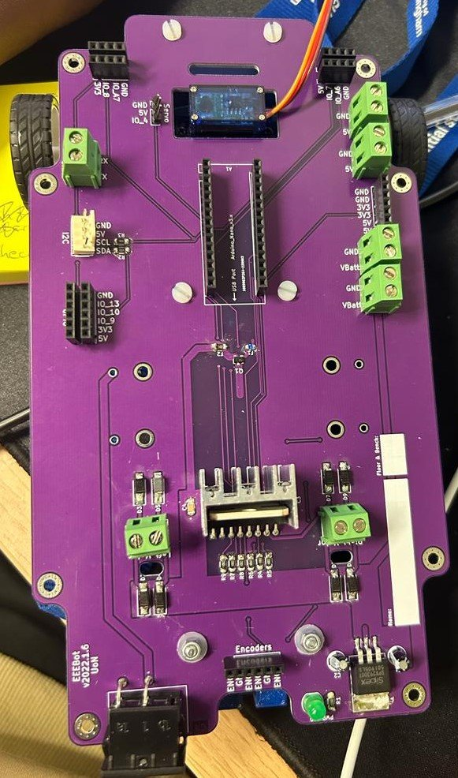
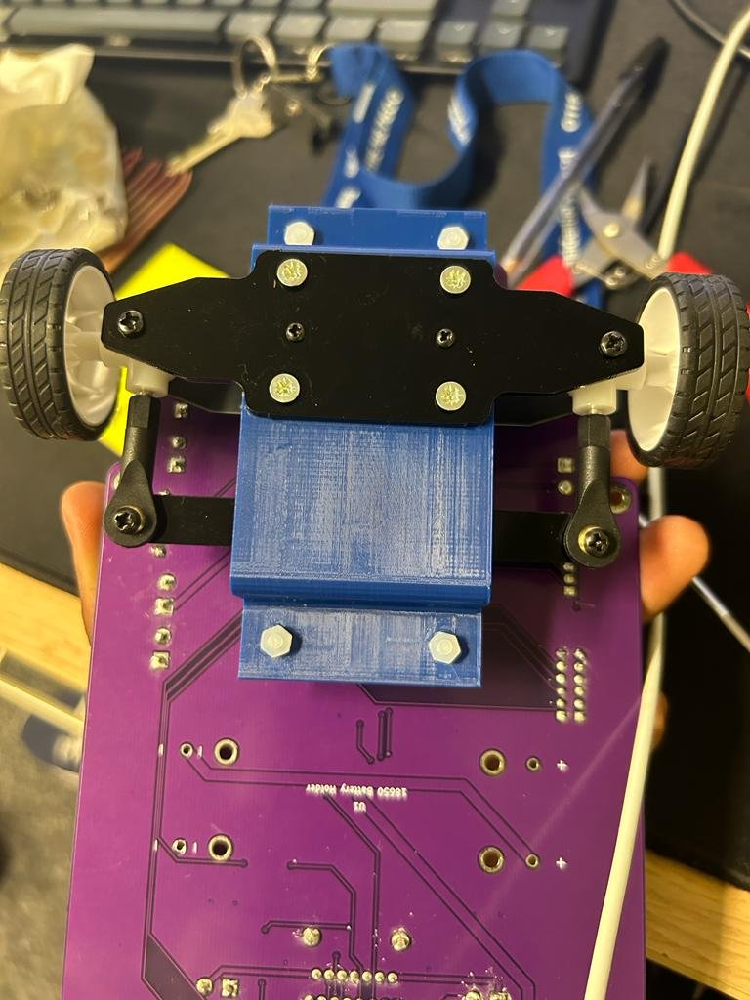
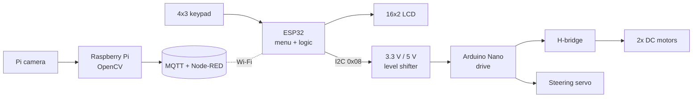

<div align="center">

  <h1>EEEBot</h1>

  <p>
    A servo-steered robot car that won the Best Maze Navigation Performance prize with a perfect maze score.
  </p>

<p>
  <a href="https://github.com/Onafuwadav/EEEBot/actions/workflows/ci.yml">
    
  </a>
</p>

<h4>
  <a href="https://onafuwadav.github.io/">Drive the maze car in my portfolio</a>
</h4>
</div>

## About the Project

EEEBot is a servo-steered robot car built for the first-year Construction Project at the University of
Nottingham. It had three tasks to complete:
 
- **Maze navigation:** Drive through a maze from commands typed on a keypad. An ESP32 reads the keypad,
  shows the command on an LCD and sends it over I2C to an Arduino Nano, which drives the motors and steering.
- **Line following:** Follow a line with IR sensors and a PID controller on the Nano.
- **Computer vision:** A Raspberry Pi camera uses OpenCV to recognise symbols and coloured lines, sharing
  results over MQTT.

### My Role
- **Maze navigation lead.** I designed and wrote the maze system: the ESP32
  keypad/LCD menu, the command protocol, and the I2C link to the Nano that
  drives the car.
- **Hardware.** I soldered the custom PCB and assembled the servo-steered
  front chassis, motors, encoders and battery pack.
  
<details>
  <summary>Prize</summary>

> "...congratulate you and your group on winning the 'Best Maze Navigation Performance' prize with the EEEBot being awarded a perfect score during the maze demonstration."



</details>

<details>
  <summary>Images</summary>
<p align="center">
  
  
</p>

</details>

### Tech Stack

[![C++][cpp-badge]][cpp-url] [![Python][python-badge]][python-url] [![Arduino][arduino-badge]][arduino-url] [![Raspberry Pi][pi-badge]][pi-url] [![OpenCV][opencv-badge]][opencv-url] [![MQTT][mqtt-badge]][mqtt-url] [![Node-RED][nodered-badge]][nodered-url]


## Prerequisites
- [Arduino cli](https://arduino.github.io/arduino-cli/)
- Python 3.9 or newer
- g++
- Optional: Raspberry Pi with a camera and MQTT for the live vision loop

```bash
arduino-cli core install arduino:avr
arduino-cli core install esp32:esp32 --additional-urls https://espressif.github.io/arduino-esp32/package_esp32_index.json
arduino-cli lib install Keypad LiquidCrystal Servo
```
 
### Installation
```bash
git clone https://github.com/Onafuwadav/EEEBot.git
cd EEEBot
pip install -e ".[test]"  
# pip install -e ".[test,pi]" # on Raspberry Pi instead for live camera loop
cd ..
```
 
### Run locally
Build each sketch, then upload it to the board:
```bash
arduino-cli compile --fqbn arduino:avr:nano firmware/nano_drive
arduino-cli upload -p <port> --fqbn arduino:avr:nano firmware/nano_drive
arduino-cli compile --fqbn esp32:esp32:esp32 firmware/esp32_menu
arduino-cli upload -p <port> --fqbn esp32:esp32:esp32 firmware/esp32_menu
```
 
Vision on the sample frames or own images:
```bash
python -m eeebot_vision symbol samples/symbol_*.png -v                
python -m eeebot_vision line samples/line_blue_right.png --colour blue
# python scripts/pi_camera_mqtt.py --broker localhost # Live loop for the Pi to MQTT
```

 
### Tests
```bash
cd vision && pytest && cd ..
g++ -std=c++11 -I control/EEEBotLineFollower/src control/tests/test_line_follower.cpp control/EEEBotLineFollower/src/*.cpp -o test_lf && ./test_lf
```


## Usage

The maze is a grid of 10 cm straights and 90° corners. Type a command on the keypad as `<order><quantity>`,
press `*` to send it, or `#` to clear it.

| Order | Move | Quantity |
|---|---|---|
| `1` | Forward | number of 10 cm steps (1 to 99) |
| `2` | Back | number of 10 cm steps (1 to 99) |
| `3` | Turn clockwise | `90` or `180` |
| `4` | Turn anticlockwise | `90` or `180` |

For example, `13` then `*` drives forward 30 cm.

<details>
  <summary>How the boards connect</summary>


</details>

## Contact

David Onafuwa: [LinkedIn](https://www.linkedin.com/in/david-onafuwa) · [Donafuwa@outlook.com](mailto:Donafuwa@outlook.com)

<!-- Tech stack badges -->
[cpp-badge]: https://img.shields.io/badge/C%2B%2B-00599C?style=for-the-badge&logo=cplusplus&logoColor=white
[cpp-url]: https://isocpp.org/
[arduino-badge]: https://img.shields.io/badge/Arduino-00878F?style=for-the-badge&logo=arduino&logoColor=white
[arduino-url]: https://www.arduino.cc/
[pi-badge]: https://img.shields.io/badge/Raspberry_Pi-A22846?style=for-the-badge&logo=raspberrypi&logoColor=white
[pi-url]: https://www.raspberrypi.com/
[python-badge]: https://img.shields.io/badge/Python-3776AB?style=for-the-badge&logo=python&logoColor=white
[python-url]: https://www.python.org/
[opencv-badge]: https://img.shields.io/badge/OpenCV-5C3EE8?style=for-the-badge&logo=opencv&logoColor=white
[opencv-url]: https://opencv.org/
[mqtt-badge]: https://img.shields.io/badge/MQTT-660066?style=for-the-badge&logo=mqtt&logoColor=white
[mqtt-url]: https://mqtt.org/
[nodered-badge]: https://img.shields.io/badge/Node--RED-8F0000?style=for-the-badge&logo=nodered&logoColor=white
[nodered-url]: https://nodered.org/
