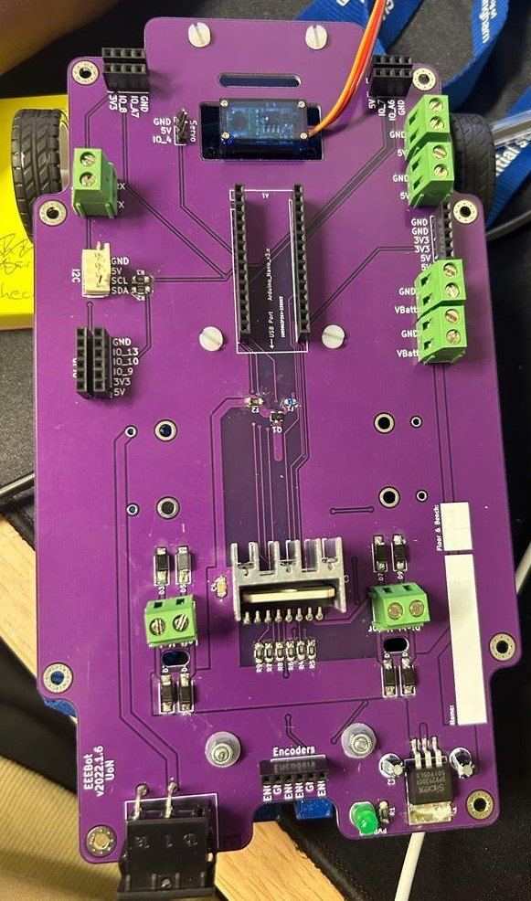
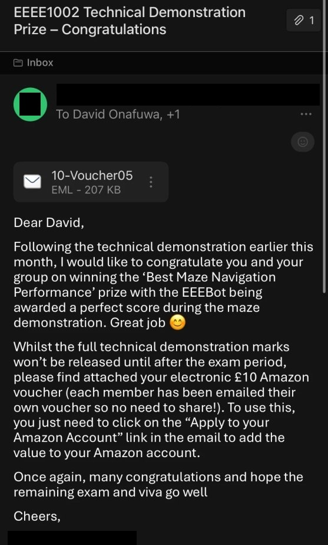
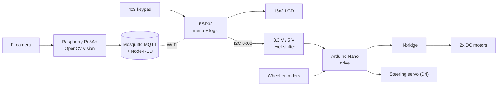

# EEEBot

[](https://github.com/Onafuwadav/EEEBot/actions/workflows/ci.yml)

A servo-steered robot car built by a team of three for EEEE1002 (Construction
Project), first year of Electrical & Electronic Engineering at the University
of Nottingham. I led the maze-navigation task, and our EEEBot won the
**Best Maze Navigation Performance** prize with a perfect score in the maze
demonstration.

<p>
  
  
</p>

## Prize

> "...congratulate you and your group on winning the 'Best Maze Navigation
> Performance' prize with the EEEBot being awarded a perfect score during the
> maze demonstration."

<details>
<summary>Prize email</summary>

</details>

## My role

- **Maze navigation lead.** I designed and wrote the maze system: the ESP32
  keypad/LCD menu, the command protocol, and the I2C link to the Nano that
  drives the car ([`firmware/`](firmware)).
- **Hardware.** I soldered the custom PCB and assembled the servo-steered
  front chassis, motors, encoders and battery pack.
- **Team tasks.** IR line following with PID, and computer vision for coloured
  lines and symbols. The code for these in [`control/`](control) and
  [`vision/`](vision).

## Architecture


The ESP32 (3.3 V) handles the user interface and logic; the Nano (5 V) drives
the motors and servo; a bi-directional level shifter sits between them on the
I2C bus. The Pi runs the camera, the MQTT broker and Node-RED. Also on board:
an HC-SR04 ultrasonic sensor and an MPU-9250 IMU.

More detail: [architecture](docs/architecture.md) · [wiring](docs/wiring.md) · [build log](docs/build-log.md)

## Maze command protocol
The maze is a grid of 10 cm straights and 90° corners. Commands are typed on
the keypad as `<order><quantity>`:

| Order | Move | Quantity |
|---|---|---|
| `1` | Forward | number of 10 cm steps (1-99) |
| `2` | Back | number of 10 cm steps (1-99) |
| `3` | Turn clockwise | `90` or `180` degrees |
| `4` | Turn anticlockwise | `90` or `180` degrees |

| Key | Action |
|---|---|
| `0`-`9` | Type the command (shown on the LCD's top line) |
| `*` | Check and send it |
| `#` | Clear it |

What happens on `*`:
1. The ESP32 checks the command (`valid_command()`) and writes its ASCII
   characters over I2C to address `0x08`. The LCD shows `Sent 13` or
   `Invalid command`.
2. On the Nano, `receiveEvent()` stores the bytes and sets a flag; the I2C
   interrupt does nothing else.
3. `loop()` sees the flag and runs `executeCommand()`: the first character is
   the order, and the rest × 100 is the distance in mm (for turns, the rest is
   the angle).
4. The Nano sets the H-bridge direction pins and the steering servo, runs the
   motors for the calibrated time (or until the encoders reach the target
   count with `USE_ENCODERS 1`), stops, and re-centres the steering.

## Repository layout

```
firmware/
  esp32_menu/     ESP32: keypad + LCD menu, sends commands over I2C (mine)
  nano_drive/     Nano: I2C slave at 0x08, motors + steering (mine)
control/          PID line follower: Arduino library + host unit tests (rebuilt)
vision/           Symbol recognition + coloured-line detection, OpenCV (rebuilt)
docs/             Architecture, wiring, build log, figures from the logbook
experiments/
  i2c-morse/      Early I2C practice: send Morse from one Arduino, decode on another
```

## Getting started

Firmware, with [arduino-cli](https://arduino.github.io/arduino-cli/):

```bash
arduino-cli lib install Keypad LiquidCrystal Servo
arduino-cli compile --fqbn arduino:avr:nano firmware/nano_drive
arduino-cli compile --fqbn esp32:esp32:esp32 firmware/esp32_menu
```

Vision (Python 3.9+):

```bash
cd vision
pip install -e ".[test]"
pytest
python -m eeebot_vision symbol samples/symbol_star.png
```

PID unit tests:

```bash
g++ -std=c++11 -I control/EEEBotLineFollower/src control/tests/test_line_follower.cpp control/EEEBotLineFollower/src/*.cpp -o test_lf && ./test_lf
```

CI compiles all five sketches with `arduino-cli` and runs both test suites on
every push.
