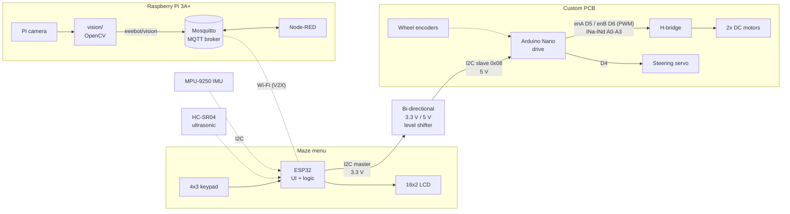
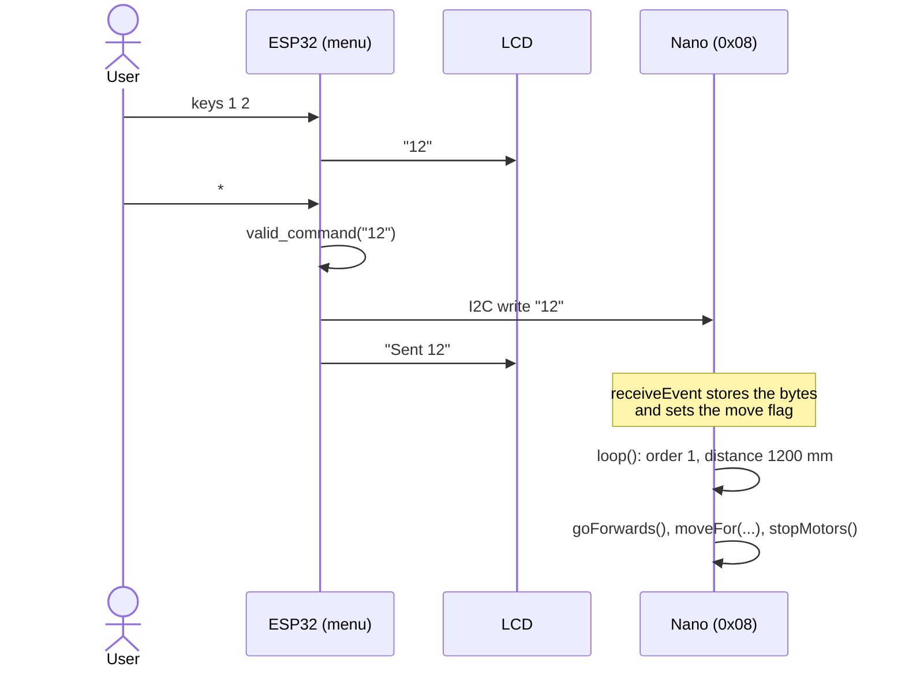
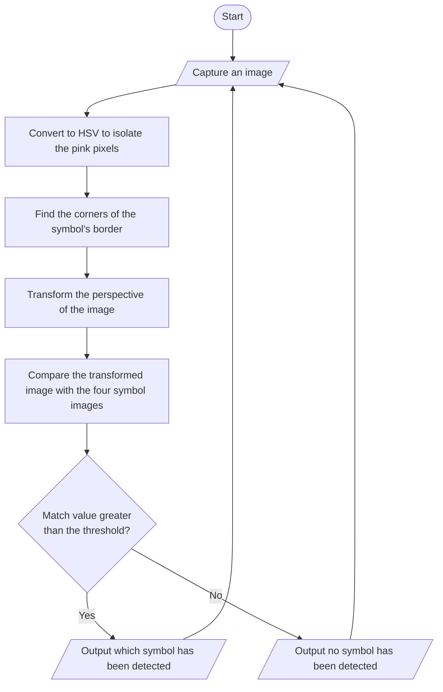
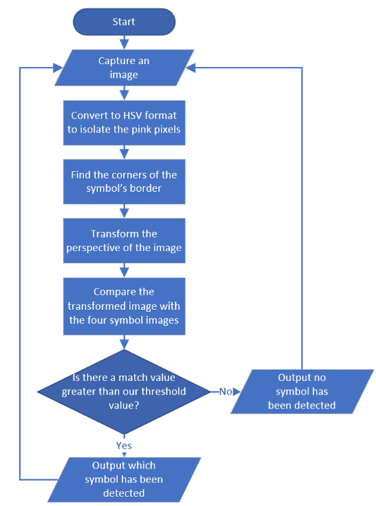
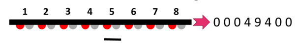
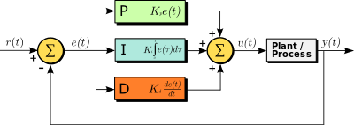

# System architecture

Solid lines are the maze-navigation path that won the prize. Dashed lines
are the sensor and V2X lab tasks.

## Who does what

| Board | Firmware | Job |
|---|---|---|
| ESP32 | [`firmware/esp32_menu`](../firmware/esp32_menu/esp32_menu.ino) | Reads the keypad, shows the command on the LCD, checks it and sends it over I2C |
| Arduino Nano | [`firmware/nano_drive`](../firmware/nano_drive/nano_drive.ino) | I2C slave at `0x08`: parses the command, drives the motors and steering servo |
| Raspberry Pi 3A+ | [`vision/`](../vision) | Symbol recognition and coloured-line position from the camera, published over MQTT |
| Nano (line task) | [`control/`](../control) | IR weighted-average position, PID, servo and motor mixing |

The ESP32 runs at 3.3 V and the Nano at 5 V, so the I2C lines go through the
bi-directional level shifter. The ESP32 uses its default I2C pins
(SDA 21, SCL 22); the Nano's are fixed at A4 (SDA) and A5 (SCL).

## Maze command flow

## Symbol recognition
[`vision/eeebot_vision/symbols.py`](../vision/eeebot_vision/symbols.py):

| Symbol | Line to follow |
|---|---|
| Circle | Red |
| Star | Green |
| Triangle | Blue |
| Umbrella | Yellow |

## Line following

The IR board has evenly spaced emitter/receiver pairs. Each reading is
proportional to how much line is under it, and the line's position is the
weighted average of the readings:

That position is the error fed into a PID controller, whose output turns the
steering servo and slows the inside wheel:

*PID diagram by Arturo Urquizo, [Wikimedia Commons](https://commons.wikimedia.org/wiki/File:PID_en.svg), CC BY-SA 3.0*

The camera-based coloured-line follower reuses the same controller: the
vision code turns the HSV mask into the same [-1, 1] position.