# Build log

Photos from my logbook, in build order.

## Front steering chassis

The servo is screwed to an acrylic plate on brass stand-offs, with plastic
6-way fittings either side for the wheels. The servo horn connects to a
short acrylic link (the hole in the horn had to be opened up first).

  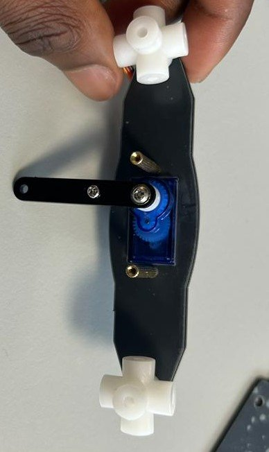
  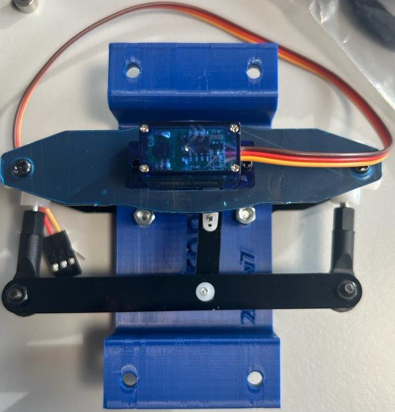

## PCB

I soldered the whole board from the schematic with no rework needed.

  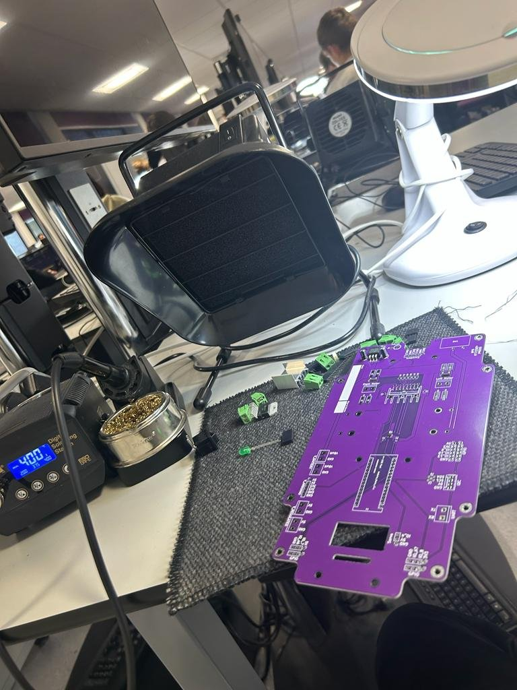
  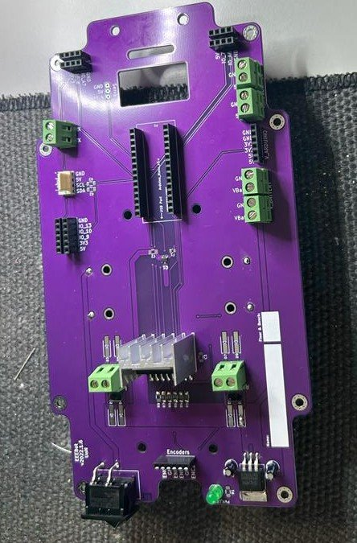

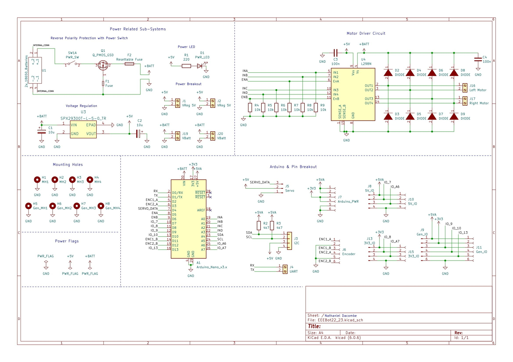

## Chassis, battery, motors

The front steering chassis bolts to the PCB on nylon spacers; the rear
chassis uses metal screws, lock nuts and 3D-printed spacers. The battery pack
was first soldered in reversed, so a pit-stop request was raised and it was
re-soldered the right way round.

  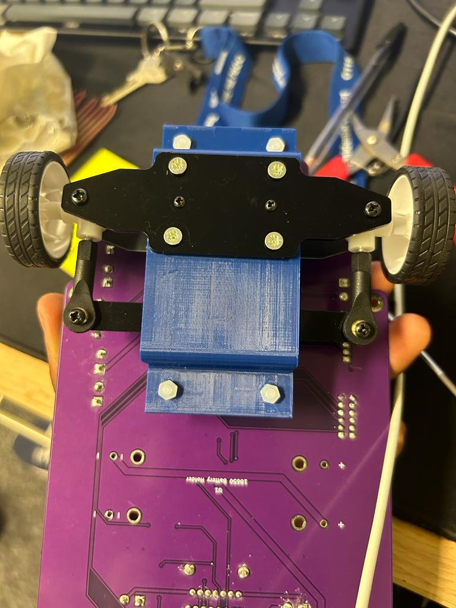
  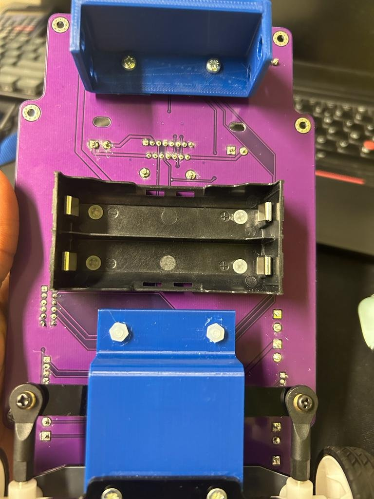
  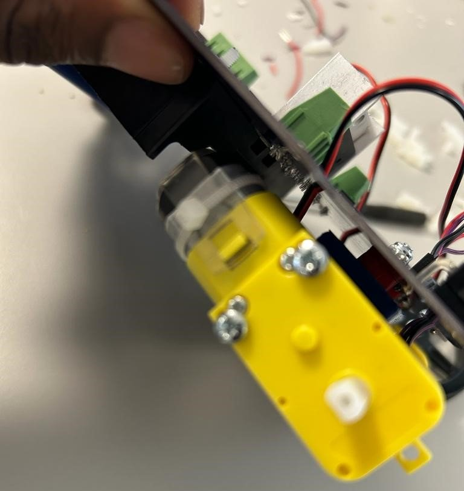

## Encoders

The encoder stripboard sits in the rear chassis cradle; its wires go to the
encoder header on the PCB.

  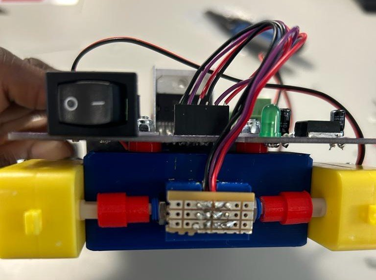
  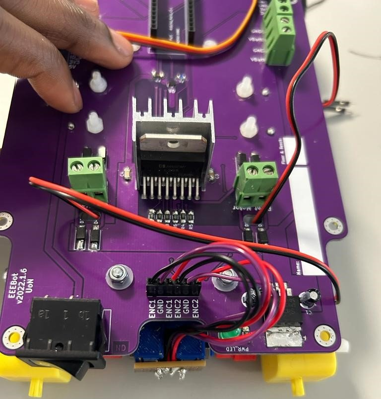

## Level shifter and line sensor

  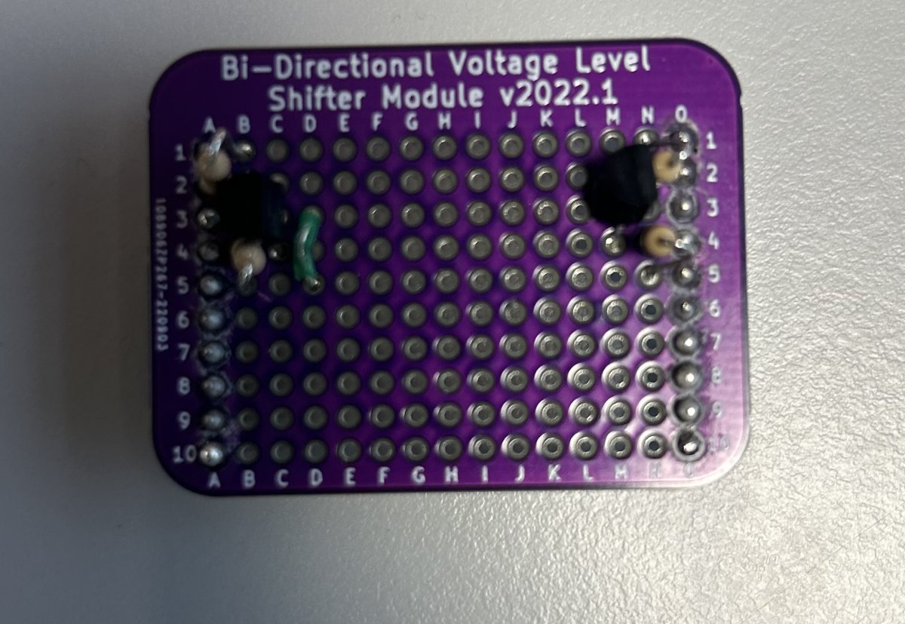
  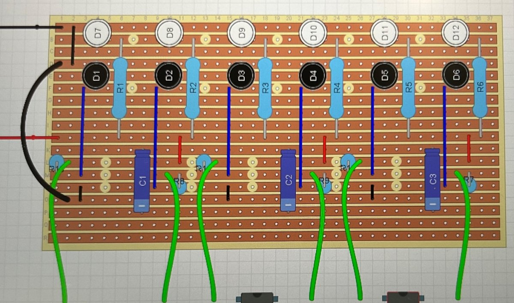

*Left: the 3.3 V / 5 V level shifter between the ESP32 and the Nano.
Right: IR emitter/receiver stripboard layout for line following.*
